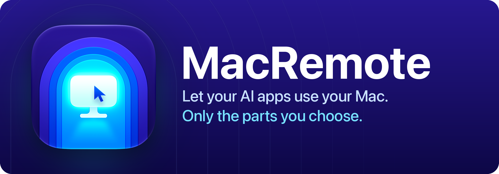

<p align="center">
  
</p>

<p align="center">
  <a href="https://github.com/viticci/MacRemote/releases"><b>Download MacRemote 1.0</b></a><br>
  macOS 26 or later · Apple silicon and Intel · Free and open source (MIT)
</p>

<p align="center">
  <a href="INSTALL.md">Install</a> ·
  <a href="docs/GUIDE.md">Guide</a> ·
  <a href="docs/releases/1.0.md">Release Notes</a> ·
  <a href="SECURITY.md">Security</a>
</p>

---

## Why I Made This

I use ChatGPT and Claude every day, on every device I own. But a lot of the
stuff I care about lives on my Mac: my reminders and notes, my files, my
podcast queue, and a pile of command-line tools I've built over the years. I
wanted my AI apps to use those things, from my iPhone or anywhere else, without
handing them a terminal and hoping for the best.

So I made MacRemote. It's a native Mac app that shares the tools you pick with
ChatGPT, Claude, and other AI apps over MCP. MCP, the Model Context Protocol,
is the standard those apps use to call tools that live outside of them.

The idea is simple: your Mac, your rules. You choose every tool an app can
see. You approve every new app on the Mac. Anything that can change something
asks you first and shows you exactly what it's about to run.

— Federico

## What It Does

- **Shares the tools you choose.** Add a command-line app, a single workflow
  from one, or a whole bundle from the Library. Apps see tools whose **Share**
  switch is on, and you can turn it off for any tool.
- **Brings your existing MCP servers along.** MacRemote can import the MCP
  servers you've already set up for Claude Desktop, Claude Code, Codex, Cursor,
  VS Code, and others, and share them from one place.
- **Moves files, carefully.** Built-in File Transfer tools can list, find,
  read, write, edit, receive, and download files, but only in the folders you
  allow.
- **Goes public in a minute.** An **Instant Link** gives you a temporary
  address with no account. **Your Domain** gives you a stable address on a
  domain you own through Cloudflare.
- **Looks good in chat, if you want it to.** Apps that support MCP Apps can
  show results as cards; turn them on for all tools or only some. Every app
  also gets the result as text and structured data.
- **Stays up on an always-on Mac.** MacRemote can open at login and bring your
  own domain back online by itself after a restart.
- **Works with my apps out of the box.** If you use RemCTL, NotesCTL,
  MailCTL, PhotoCTL, MusicCTL, or Apple Frames, MacRemote finds them, keeps
  their tools current, and knows how to share them safely. All of them are
  optional.

## How It Keeps Your Mac Yours

MacRemote is not a remote shell, and that's on purpose.

- **No shell, ever.** Every tool runs as one exact program with an exact list
  of arguments. There are no pipes, wildcards, or `~` expansion, and shells
  like `bash` and `zsh` can't be added as tools.
- **You approve every app.** A new app shows a six-digit code in its sign-in
  page and in MacRemote. Approve only when they match.
- **Tools that change things ask first.** You see every argument in full,
  invisible characters included, before anything runs. You can choose
  **Always Allow** for one app and one tool when you trust it.
- **The server stays on your Mac.** MacRemote listens only on this Mac.
  Cloudflare carries requests to it, but MacRemote checks every sign-in
  itself.
- **Secrets stay put.** SSH keys, cloud credentials, Keychains, and other
  protected locations are never reachable through File Transfer, even if you
  allow the whole Mac.
- **You can pull the plug anytime.** Sign out one app or all of them, or stop
  the public link. Quitting MacRemote always stops it too.

The full design is in [Architecture and Security](docs/ARCHITECTURE_SECURITY.md)
and the [Threat Model](docs/THREAT_MODEL.md).

## Get Started

You need macOS 26 or later, an AI app that can connect to an MCP server (like
ChatGPT or Claude), and at least one tool to share. You don't need Xcode,
Homebrew, or a Cloudflare account. MacRemote installs and verifies the one
helper it needs by itself.

1. **Download it.** Get `MacRemote-1.0-macos-universal2.zip` from the
   [latest release](https://github.com/viticci/MacRemote/releases) on GitHub.
2. **Install it.** Unzip it, move **MacRemote** to Applications, and open it.
   It's signed and notarized by Apple, so it opens like any other app.
3. **Pick a tool.** For your first test, select **Current Date** in the
   Welcome window. It's read-only and built into macOS.
4. **Go public.** Choose **Instant Link**, install the helper if asked, and
   choose **Start Instant Link**.
5. **Connect your app.** Paste the public URL, which ends in `/mcp`, into
   ChatGPT, Claude, or another MCP app. Your browser and MacRemote both show a
   six-digit code. Approve the request in MacRemote only when they match.

That's it. Ask your AI app what day it is, and the answer comes from your Mac.

[INSTALL.md](INSTALL.md) covers the first run in detail, including how to
check that the app is the notarized one and how to set up a permanent address
with [Your Domain](INSTALL.md#your-domain).
ChatGPT users should also read
[Connect ChatGPT](docs/CHATGPT.md).

## Documentation

| Read this | For |
|---|---|
| [Install](INSTALL.md) | Your first run, step by step, and building from source |
| [Guide](docs/GUIDE.md) | Everything else: sign-in methods, Cloudflare, approvals, File Transfer, permissions, and troubleshooting |
| [Connect ChatGPT](docs/CHATGPT.md) | Adding MacRemote to ChatGPT, and what has not been checked yet |
| [Federico Viticci tools](docs/FEDERICO_CLI_TOOLS.md) | What MacRemote shares from my command-line apps |
| [Release notes for 1.0](docs/releases/1.0.md) | What MacRemote 1.0 does, and its known limits |
| [Security](SECURITY.md) | The rules, and how to report a problem |
| [Architecture and Security](docs/ARCHITECTURE_SECURITY.md) · [Threat Model](docs/THREAT_MODEL.md) | How it all works, and why |

## Building From Source

MacRemote is a Swift package with no Xcode project.
[Build from source](INSTALL.md#build-from-source) covers building, testing, and
packaging a release.
[CONTRIBUTING.md](CONTRIBUTING.md) and [AGENTS.md](AGENTS.md) have the rules
for changing it.

```text
App/        SwiftUI app entry point
Models/     Domain models
Services/   Server, tunnel, sign-in, process, and tool services
Stores/     App state and persistence
Views/      SwiftUI views
Support/    Formatting and small helpers
Widget/     The page that shows formatted results in MCP apps
Shaders/    Metal shader for the light behind the connection status
Resources/  Icon, bundled assets, and third-party notices
Tests/      Swift and Python tests
Tools/      Icon and banner build scripts, stress and benchmark harnesses
docs/       Guides, design, security, and release notes
script/     Build and release scripts
```

## License

MIT. Use it for anything; keep the copyright notice and the permission notice
with every copy. See [LICENSE](LICENSE); the app carries the same file in
`MacRemote.app/Contents/Resources/LICENSE`.
The third-party app icons in `Resources/ConnectedAppIcons` keep their own
terms.

---

<p align="center">
  Made by <a href="https://www.macstories.net">Federico Viticci</a>.<br>
  Copyright © 2026 Federico Viticci.
</p>
